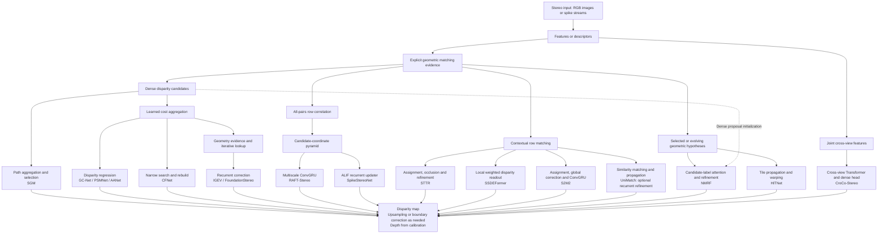

# Spiking depth estimation

**North star: make a spiking Transformer estimate accurate depth from a stereo pair of intensity-spike cameras.** This repository contains SpikeStereoNet and our existing model implementations, with the Obsidian master sheet as the research record.

README assembled **6 November 2026**. The master-sheet evidence below retains its original **5 November 2026** date. Its results and cluster-status statements describe that audit, not a fresh evaluation or a live job monitor. The new portable runner has not reproduced those historical scores.

[Working evidence](#working-evidence) · [Stereo architecture map](#stereo-architecture-map) · [Architecture choices](#architecture-choices) · [Papers and reading order](#papers-and-reading-order) · [Research direction](#research-direction) · [Running the code](#running-the-code)

<a id="working-evidence"></a>
## Obsidian master sheet

The following reproduces the current master-sheet content, with headings and local links adapted for GitHub. [Spiking Transformer.md](Spiking%20Transformer.md) preserves the exact Obsidian Markdown. Archive footnotes identify supporting files that remain in the original Research repository; they have not been imported here.

## Spiking Transformer stereo: working evidence

Updated **5 November 2026**. Latest read-only cluster check: **13:04 Shanghai / 05:04 UTC**.


| Paper          | Year | Input   | Camera | Architecture                                 |
| -------------- | ---- | ------- | ------ | -------------------------------------------- |
| SpikeStereoNet | 2026 | Spiking | Stereo | Feature map + Standard cost volume + RSNN    |
| RAFT-Stereo    | 2021 | RGB     | Stereo | Feature map + Standard cost volume + ConvGRU |
| STTR           | 2021 | RGB     | Stereo | Feature map + Transformer + Optimisations    |
| SSDEFormer     | 2022 | Spiking | Stereo | Feature map + Transformer                    |
|                |      |         |        |                                              |


### 1. North star

**Develop a useful, distinctive method for stereo depth from spike-camera input, and identify what actually produces its gains.** Separate learned content routing, the signed forward code, its surrogate training gradient, and the current pathway into the recurrent decoder. Improving an existing architecture can be a worthwhile contribution; a better explanation alone does not establish novelty or publication readiness.

**Current evidence:** A's spiking configuration has lower mean EPE than its corresponding tanh control under both routing designs in **two completed seeds**. Content-dependent routing is not a consistent winner: spiking positional wins seed 2345. The strongest current-reference model remains retrained **no-attention v0, 1.851657 px**, measured at seed 1234. Guided v0 beats Original but loses to its own no-attention parent. B remains the strongest A/B/C placement at seed 1234, **2.034117 px**; these placement rankings have not been replicated with the new A-control seed.

**Working mechanism, not an established cause:** cost preparation and normalized current may help the recurrent decoder use evidence without improving the strongest raw match. The CPU interventions below identify strong dependence on cost offsets in trained B. They do not show that offsets explain its gain after independent retraining. The forward-code versus surrogate-gradient question remains open.

**Common 30k protocol:** native Synthetic, all 50 input bins, 250 × 400; 960 Train frames from 120 scenes, 60 Dev frames from 30 scenes; effective batch 8 (4 × accumulation 2), HV flips, AdamW peak LR 2e−4, fixed 30k OneCycle, 16 training/32 evaluation refinements. Each endpoint uses 240,000 presentations. EPE is mean-scene disparity error in native pixels; bad3 is percent over 3 px; lower is better. These are Dev results, not untouched-test results.

**Naming:** guided v0 was previously called “C”; it is distinct from recurrent placement C. Older feedforward B and pyramid-free A are separate experiments. “Continuous” in the current A factorial means **tanh Q/K/V**, not every possible conventional Transformer.

### 2. Completed experiments and what they tell us

#### Architecture comparison · seed 1234

All primary rows are seed 1234, fixed 30k. Controls share endpoints, rather than constituting additional independent replications.

| Model                      | Intervention / matched parent                                                            | EPE ↓ / bad3 ↓         | Interpretation                                                                                                                               |
| -------------------------- | ---------------------------------------------------------------------------------------- | ---------------------- | -------------------------------------------------------------------------------------------------------------------------------------------- |
| Original non-I             | Native CNN, correlation pyramid, ALIF updater                                            | **2.691127 / 10.712%** | Shared reference.                                                                                                                            |
| Full normalized v0         | Normalized multiscale LIF attention/current/FFN updater                                  | **1.990950 / 9.610%**  | Package gain; does not isolate attention.                                                                                                    |
| No-attention v0, retrained | Remove/freeze v0 attention; retain normalized current, FFN and recurrence                | **1.851657 / 9.393%**  | Best reference; most package benefit survives without attention.                                                                             |
| Guided v0                  | Spiking Q/K over 36 signed candidates, gated correction; parent=no-attention v0          | **1.92164 / 9.277%**   | −0.76948 versus Original, **+0.06999 versus parent**. Wins 17/30 parent scenes; scene 0123 dominates loss. Positional follow-up gate failed. |
| Placement A / SC           | Five-candidate disparity-axis cost filter before native pyramid                          | **2.159759 / 10.423%** | −0.531368 versus Original; 15/30 scene wins. Four scenes supply 89% of net gain.                                                             |
| Placement B                | Bidirectional epipolar feature exchange before correlation                               | **2.034117 / 9.626%**  | −0.657010 versus Original; 23/30 wins; beats A in 21/30 scenes. Four scenes supply 68% of gain.                                              |
| Placement C, recurrent     | Source-token spiking Transformer replaces multiscale ALIF updater                        | **2.827199 / 11.254%** | +0.136072 versus Original; 11/30 wins. Scale structure/capacity also change.                                                                 |
| A / SP                     | Retrained spiking, positional Q/K; content-bearing V                                     | **2.481007 / 10.781%** | SC better by 0.321248 at this seed.                                                                                                          |
| A / CC                     | Retrained `tanh` Q/K/V; content routing, support/projections/norm/residual matched to SC | **2.778887 / 10.575%** | SC better by 0.619128; 17/30 wins, but median gap only 0.0068.                                                                               |
| A / CP                     | Retrained continuous, positional Q/K; content-bearing V                                  | **2.868223 / 10.459%** | CC better by 0.089337 EPE; CP has lower bad3.                                                                                                |
| Compact S²M² v2b           | Separate compact spiking matching/refinement system                                      | **4.703018 / 35.664%** | Loses to Original; does not evaluate the published system.                                                                                   |

Verified A/B/C endpoints and diagnostics[^archive-1] · v0 paired endpoints[^archive-2] · Guided interpretation[^archive-3].

A/B replay matches all 60 official frames. B improves its own raw candidate rank/argmax slightly, yet remains worse than Original on these correspondence measures. A's rank improves but top-1 worsens. **Decoder-compatible cost shaping** is therefore a hypothesis worth testing; better final depth does not establish more accurate raw match selection. C briefly beats Original at refinement 8, then accumulates an in-view deficit by refinement 32.

#### Experiment A · two completed 30k seeds

All four rows use Original's CNN, native correlation pyramid and ALIF updater, with the same added five-candidate cost-filter architecture. They differ in coding and the input to Q/K. Each seed has identical exposure and the same 60 Dev frame identities/valid counts across its four arms.

| A control | Seed 1234 EPE ↓ | Seed 2345 EPE ↓ | Two-seed mean EPE ↓ | Seed 2345 bad3 ↓ |
|---|---:|---:|---:|---:|
| SC · spiking content | 2.159759 | 2.193481 | 2.176620 | 10.455% |
| SP · spiking positional | 2.481007 | 2.074089 | 2.277548 | 10.025% |
| CC · tanh content | 2.778887 | 2.299441 | 2.539164 | 10.223% |
| CP · tanh positional | 2.868223 | 2.632070 | 2.750147 | 11.236% |

The two-seed mean weights the seeds equally; it is descriptive, not a completed three-seed significance/equivalence result. **SC wins seed 1234; SP wins seed 2345.**

**What SP means:** Q/K use learned projections of normalized candidate right-x position, with the correlation input zeroed. V still receives correlation and position. Its weights can be learned and nonuniform, but do not change with the sample's matching costs. SC uses matching cost and position for Q/K as well as V. Both mix the same five neighbors. SP is therefore a content-independent routing control, not a removal of stereo information.

| Contrast; positive favors the named effect | Seed 1234 | Seed 2345 | What follows |
|---|---:|---:|---|
| Signed coding advantage with content routing: CC − SC | +0.619128 px | +0.105960 px | Lower mean EPE repeats, but the advantage shrinks substantially. |
| Signed coding advantage with positional routing: CP − SP | +0.387217 px | +0.557981 px | Lower mean EPE repeats under positional routing too. |
| Content-routing advantage with signed coding: SP − SC | +0.321248 px | **−0.119392 px** | Direction reverses; content routing is not a consistent improvement. |
| Content-routing advantage with tanh: CP − CC | +0.089337 px | +0.332629 px | Content beats position in these two continuous runs. |
| Coding × routing interaction: (SP − SC) − (CP − CC) | +0.231911 px | **−0.452021 px** | No stable interaction direction across these seeds. |

**Strongest supported claim:** the signed-spiking training configuration achieves lower mean EPE than the tested tanh configuration in both seeds and under both routing designs. This comparison bundles the forward transfer function, internal T4 dynamics and backward derivative; it does not identify discrete spikes as the cause or establish superiority over conventional attention generally.

**Scene and metric qualifications:** seed-1 SC beats CC in 17/30 scenes; scene 0134 contributes about 92% of the net mean gap. Removing it descriptively leaves 0.0521 px, but it stays in the primary mean. In seed 2, SC beats CC in only **12/30 scenes**, with a median CC−SC difference of **−0.01415 px** and slightly worse bad3 (**10.455% vs 10.223%**). Its lower mean EPE comes from larger improvements in fewer scenes. SP beats SC in **20/30 scenes** in seed 2. There is no admitted seed-2345 Original endpoint here, so **A's improvement over Original has not yet been replicated across two seeds**.

Saved second-seed endpoints[^archive-4] · Fresh endpoint/status audit[^archive-5] · Registered factorial and inference rules[^archive-6].

#### Frozen interventions and historical retraining

**A/B coding:** signed-rate T4 followed by continuous softmax. A constant projected current is encoded for four internal neuron steps; these are not four sensor observations. The models retain analog operations, and replacing internal codes does not remove any of the 50 sensor bins.

**Frozen probes measure checkpoint reliance; retraining measures whether the component is needed after learning.** At A's 30k checkpoint, branch-off/uniform/`tanh` gives **4.8436/2.8693/2.1716**, versus 2.1598 baseline. At B's earlier **23,665** checkpoint these give **2.7386/2.4156/2.1306**, versus 2.0631. They are not B's final-checkpoint ablations. Full-v0 attention-off raises 1.9909→2.2931, despite the better retrained no-attention result. Guided gate-off raises 1.9216→1.9937; score shuffle changes little and does not establish correspondence-specific benefit.

Historical three-seed, batch-2/no-flip studies found full v0 **2.1015**, no-attention **2.1685**, minimal-current LIF **2.1810**, versus Original **3.3530**. Independent normalized-current rescue also helped Original in two 5k seeds. However, a batch×flip factorial changed rankings (B8/HV at 10k: Original **2.4431**, current-I **2.1839**, v0 **2.7719**). These motivate current-pathway controls under today's recipe; they are not extra current-protocol replications. Earlier architecture screens, loss repair, smooth-signaling and diagnostic details remain in the archive.

**Historical conventional-attention comparison:** a separately trained non-SNN updater used continuous Q/K/V, softmax and sigmoid hidden states, bypassing the LIF neurons. At the earlier 10k, batch-2/no-flip protocol, its three-seed mean was **2.1989 px**, versus **2.1015 px** for the LIF updater; LIF won all three paired seeds. This compares updater operators, changing neuron dynamics and attention normalization together. It is **not** an A-site conventional-attention control under the current 30k recipe. Conventional-attention report[^archive-7].

#### CPU mechanism investigation · completed 5 November

These small interventions explain dependence within trained models; they do not measure the benefit of independently trained replacements. A reuses its earlier completed two-case replay. B uses new 30k-checkpoint replays on **0120/0001 and 0123/0001**, selected explanatory cases rather than a representative dataset sample.

| Test / architecture | What was changed | Finding | Interpretation limit |
|---|---|---|---|
| Trained A, two native cases | Match unfiltered cost rows to the filter output's mean/std, keeping decoder fixed | Recovers **73.7% / 75.9%** of bypass EPE damage. Learned profile still gives better EPE/bad3; fixed five-neighbor smoothing fails. | Calibration and learned shape both matter in these fitted cases; this is not a causal percentage of the training gain. |
| Trained B, two native cases | Match pre-exchange cost rows to post-exchange row mean/std | Recovers **80.8% / 93.4%** of bypass EPE damage. | Uses statistics of the computed trained output; not an independent fast replacement. |
| Trained B, same cases | Restore only row mean; separately restore only row std | **Mean shift: 79.0% / 89.2% recovery. Scale only: 5.2% / 4.3%.** | A common row shift preserves candidate ordering and score differences, yet changes decoder behavior substantially. The shift can still encode image-dependent information. |
| Trained B, same cases | Uniform opposite-row mixing; separately signed codes → tanh | Uniform EPE **0.9015 / 3.1781**, tanh **0.9082 / 2.9591**, trained baseline **0.9021 / 2.9291**. | Learned mixing helps the harder case; exact forward spike values have small effects on these two frames. This is not a new full-Dev 30k ablation. |
| Normalized-current v0 equations | Tiny synthetic current gain/offset change before LIF | GroupNorm nearly removes that common gain/offset before membrane evolution. | Explains an operating property; does not isolate the cause of trained EPE gains. Historical no-attention/minimal-cell retraining is stronger evidence for the current-path package. |
| Guided v0, cached full-Dev probes and tiny equation check | Gate off, content shuffle; examine bounded Q/K scores | Guided v0 remains worse than its retrained parent. Switching guidance off scarcely changes its large scene-0123 failure. Four-bit heads have logits in [0,2], so correction is soft, not a sharp 36-way selector. | The branch is used; reliable content-specific selection and incremental mean-EPE benefit are unproven. The bound does not show that sharper attention would improve EPE. |

**Most useful new lead:** learned cost preparation may partly act through the numerical bias presented to the recurrent decoder, rather than better ranking alone. A's cached full-Dev analysis finds raw argmax error worsens in all 30 scenes after filtering, while removing the filter harms the fitted decoder in all 30. A/B preserve the native solver, which need not be invariant to cost offsets. Test a trainable calibration control before treating this explanation as a new method or combining all modules.

**Scope:** B used 115 seconds of CPU model computation including an initial corrected metric-mask error; 18 saved predictions were independently checked, weights stayed unchanged, and no GPU was used. CPU baseline EPE differed from historical GPU values by −0.00113/−0.01452 px, so all new effects are within-CPU contrasts. Full CPU findings and exact tables[^archive-8] · Earlier A CPU controls[^archive-9].

#### Forward spikes versus surrogate gradients · CPU validation complete

The deciding experiment independently controls the **forward values** and **local training derivative**, with A's content routing and all other training settings fixed:

| Forward values | Backward derivative | Evidence status |
|---|---|---|
| Signed T4 code | Original surrogate through T4/soft reset | Existing SC training results |
| Continuous tanh | Ordinary tanh derivative | Existing CC training results |
| **Continuous tanh** | **Original signed recurrence's surrogate derivative** | CPU control validated; **not trained** |
| **Signed T4 code** | **Tanh-shaped derivative** | CPU control validated; **not trained** |

CPU checks used A's trained filter weights with three tiny synthetic cost rows. All four combinations passed in FP32/FP64, including checkpoint recomputation. Changing only the derivative left output values **bitwise identical** while changing Q/K/V gradient magnitude and direction. Existing signed/signed and tanh/tanh outputs and gradients matched their controls. No optimizer steps, native-frame inference or EPE measurements were performed in this check.

At current 4, the signed/tanh forward values are **1 / 0.999329**, while their original derivatives are **0.062651 / 0.001341**—about a 47× difference. This makes a gradient explanation plausible; it does not establish that larger gradients improve stereo learning.

**Decision after matched training:** if continuous values with the signed derivative retain the gain, discrete forward values are unnecessary for that recovered benefit. If signed values with tanh-shaped gradients retain it, the forward coding function contributes. If only the original combination wins, investigate interaction; if both crossed controls work, both may offer sufficient routes. A forward-code benefit would still need a smooth range/dead-zone-matched control before attributing it specifically to discreteness. An inference-only gradient swap cannot answer the training question.

CPU validation and exact training comparison[^archive-10].

### 3. Current status and outstanding experiments

**Fresh read-only audit: 5 November, 13:04 Shanghai. No jobs are running or queued for this account.** The old 2869–2872 chain and partial-step counters below the previous note are superseded by completed replacement jobs **2885–2888**.

| Study / seed | Baseline and change | Completed evidence | Remaining work / status |
|---|---|---|---|
| A/B/C placements / 1234 | Original plus cost filtering / feature exchange / updater replacement | All three 30k endpoints | One-seed placement comparison complete. |
| Phase 2 / 1234 | A coding × routing controls; shared Original reference | All five 30k endpoints, including reused Original/SC | Complete for this seed. |
| Phase 2 / 2345 | Same A factorial, new paired seed | **SC/SP/CC/CP all complete at 30k**, jobs **2885/2886/2887/2888**, all exit 0:0 | Original has no run directory/admitted endpoint in this audit. |
| Phase 2 / 3456 | Registered third seed of Original plus four A controls | No run directories observed | Not started in the audited phase-2 tree; not queued. |
| Whole registered replication matrix | 13 new training tasks, plus reused seed-1234 Original/SC | **7/13 new tasks complete** | Six without completed endpoints: Original2345 and all five seed3456 arms. |
| Forward/backward factorial | Existing SC/CC plus two crossed derivative/forward controls | Scalar and full-filter CPU checks complete | New training controls are proposed, not submitted. |
| Calibration / B uniform controls | Same decoder; learned row-offset or normalization replacement, or uniform descriptor exchange | Frozen CPU evidence only | Independent retraining remains proposed. |

Current cluster/status receipt[^archive-11]. The registered phase-2 practical difference is **0.05 px**; its formal classification requires the specified three seeds and scene-level intervals. Two-seed directional agreement does not satisfy that rule. All valid controls follow the fixed 30k endpoint regardless of interim ranking. No new jobs were submitted for this update; proposed experiments are not a running queue. Stopped E4, pyramid-free A and old v0 replication remain stopped. Encoder conversion is separate: *Converting SpikeStereoNet into full SNN* (separate Obsidian note; not included).

### 4. Paper direction and deciding questions

**There is no percentage-improvement threshold that separates CCF-B from CCF-A.** A targeted improvement to an existing architecture can support a CCF-A paper when its contribution is distinctive, useful and convincingly evaluated. Conversely, an ordinary bias/normalization fix that only improves one inherited baseline may remain limited, even with a large EPE gain. Explaining an engineering change more scientifically does not by itself create novelty.

The present evidence supports a mechanism investigation, not an established CCF-A contribution. Two promising questions are **how matching-cost calibration interacts with recurrent updates**, and **whether the signed training derivative helps learn useful representations without requiring discrete inference codes**. Neither requires abandoning the native dataset to run the next deciding experiment.

| Question before writing a strong paper | Next deciding evidence | What it would establish |
|---|---|---|
| Does the code advantage survive replication and fair controls? | Complete registered seed/baseline matrix; report EPE, bad3, scene tails and seed variability. Give continuous alternatives comparable tuning. | Scope and consistency of the advantage; no universal SNN claim. |
| Is the benefit in forward values, the backward rule, or their combination? | Train the two crossed controls from matched initial states, initially at the two existing seeds. Keep the native diagonal implementations. | Separates the interventions under this recipe; CPU validation alone cannot decide the winner. |
| Is cost calibration learnable without the full attention block? | Compare a small learned row-offset adapter and plain centered/standardized costs with the matched original model and B. Controls must use raw inputs, with no trained-output Y statistics. | Whether the frozen CPU shortcut is a sufficient deployable replacement after learning. |
| Does a new method improve the strongest relevant parent? | Test incremental value against retrained no-attention v0; preserve current/decoder interfaces. A minimal-current retrain under the current recipe explains v0 separately. | Avoids attributing inherited gains to added guidance or attention. |
| Is there a distinctive contribution beyond known attention/normalization/confidence methods? | Identify a reproducible failure and a specific solution that beats strong simple alternatives; check closest prior art once the successful mechanism is concrete. | A possible CCF-A methods/empirical contribution. A simpler baseline improvement alone may justify a narrower story. |
| Does the claim generalize, and at what cost? | An independently evaluated cohort or relevant transfer setting; matched latency/memory/energy only if claimed. For sensor robustness, connect cost changes to actual acquisition changes. | Evidence proportional to the claimed contribution, rather than artificial perturbations alone. |

**Immediate priorities:** finish interpreting the registered replication; use the crossed forward/backward experiment to answer the spiking-specific question, and a trained calibration control to test the simpler explanation. These are plans, not new launch authorization. Avoid stacking A+B+guidance+I before identifying which component adds value.

**Venue framing:** a focused CCF-B submission could center on a narrower validated improvement and careful controls, subject to venue fit. A credible CCF-A direction would offer a consequential, distinctive method or finding beyond one configuration, with appropriate comparisons and evidence. A universal theory, new sensor, entirely new architecture or arbitrary number of datasets is not a prerequisite; acceptance is not established by this notebook.

**Closest-work context:** [FoundationStereo](https://arxiv.org/html/2501.09898v1) already uses disparity-axis attention; [Selective-Stereo](https://openaccess.thecvf.com/content/CVPR2024/html/Wang_Selective-Stereo_Adaptive_Frequency_Information_Selection_for_Stereo_Matching_CVPR_2024_paper.html) is a precedent for a targeted updater improvement in existing stereo backbones. Placement alone is not our novelty. Verified Middlebury-paper novelty comparison[^archive-12].

All 40 native Test scenes were used historically and cannot now be called untouched confirmation. Existing data still supports the controlled mechanism study. New scenes or an external benchmark would strengthen independent generalization evidence. No field-wide SOTA, sensor-time attention or energy advantage has been established.

CPU-informed direction report[^archive-13] · Earlier roadmap (its 4 November status is historical)[^archive-14] · Backup before this update[^archive-15] · Full older experiment notebook[^archive-16].


What about transformers for spiking cameras but monocular, could we see their failure modes and perhaps understand how to implement it for stereo vision?

<a id="stereo-architecture-map"></a>
## Anatomy of stereo depth estimation

For a calibrated, rectified pair, a visible surface point appears on the same image row in both views. Finding its horizontal displacement gives disparity: `d = x_left - x_right`. With aligned principal points, `Z = f B / d`, where `f` is focal length in pixels and `B` is the camera baseline. Camera calibration supplies any principal-point correction. The difficult part is deciding which pixels correspond, especially with repeated textures, weak texture, occlusion and depth boundaries.

A useful separation is **matching evidence → reasoning about competing matches → disparity readout/refinement**. A cost volume stores candidate evidence. An RNN supplies an update rule with memory. Attention chooses which features or candidates exchange information. A pyramid changes resolution. These operations can coexist.

### Pipeline map: follow each paper to disparity

Arrows show information flow, not historical descent or a performance ranking. The diagram is a map of reusable components; the mutually exclusive classification is given separately below. Paper links and variants are in the reading tables.



**Crossovers matter.** All-pairs row correlation is itself dense matching evidence. STTR and SSDEFormer still compute matching scores despite avoiding a conventional fixed-disparity volume. NMRF uses dense evidence to initialize sparse proposals. FoundationStereo combines attention, volume processing and recurrence. CREStereo combines a feature-scale cascade, adaptive correlation and recurrent updates. AANet also has refinement beyond its aggregation/readout. The map highlights their main differences, not every layer.

### Three shared paths in plain text

```text
RAFT-Stereo     CNN features       → row correlation → candidate pyramid → ConvGRU → disparity
SpikeStereoNet spike-stack CNN    → row correlation → candidate pyramid → RSNN    → disparity

GC-Net/PSMNet   CNN features       → candidate volume → 3D aggregation → readout
IGEV           CNN features       → geometry volume + correlation → lookup → ConvGRU
Foundation     adapted features   → attentive cost processing → recurrent refinement

STTR           CNN + attention    → row assignment → readout and contextual refinement
S2M2           multiscale features→ row assignment → global correction + ConvGRU
NMRF           CNN features       → proposals → candidate/spatial messages → refinement
CroCo-Stereo   ViT features       → cross-view decoder → dense disparity head
```

### MECE design questions

A whole architecture is a combination of answers. “Transformer,” “cost volume” and “RNN” are not mutually exclusive families.

| Design question | Mutually exclusive answers | What this distinguishes |
|---|---|---|
| Is geometric matching evidence explicit? | No; or yes with only dense candidates; only selected/adaptive candidates; or both at different stages | Direct joint-feature regression versus explicit candidate reasoning. A local lookup into a dense field is not a sparse-only representation. |
| Does a geometric estimate feed a later estimation step? | No; only separately parameterized update stages; only a repeated shared update rule; or both | One estimation stage, fixed cascade, shared iteration, or a cascade containing shared iterations. |
| What state passes between repeated updates? | No repeated updates; geometric estimates/evidence only; or also learned latent state | Iterative geometry versus recurrent hidden state, neuron state or token memory. |
| Is attention used at a particular stage? | Yes or no, independently for feature extraction, matching, aggregation and refinement | Where attention actually contributes. |
| Is a particular quantity multiscale? | Yes or no, independently for image/features, candidate coordinates and updater state | Which kind of pyramid is present. |

These outcomes are exhaustive for the stated questions and scoped rectified-stereo setting; they are not a taxonomy of every possible network detail. Sinkhorn assignment iterations are distinct from disparity-refinement iterations. A deep Transformer is not recurrent merely because it has many layers.

<a id="architecture-choices"></a>
## Why choose each mechanism?

| Mechanism | Problem it addresses | When it is useful | Main trade-off |
|---|---|---|---|
| Cost/correlation volume | Several disparities look plausible; an early winner discards alternatives | Preserve candidate scores for later geometric/contextual reasoning and diagnosis | Dense storage/processing grows with candidate count; a correct score need not become a correct final estimate. |
| Feature pyramid | Local texture alone cannot explain large displacements or broad context | Combine coarse reasoning with fine boundary recovery | Thin structures can disappear at coarse resolution. |
| Candidate-coordinate pyramid | A small lookup window cannot cover both broad search and precise matching | Query coarse and fine matching evidence around the current estimate | Pooling can merge nearby peaks; lost distinctions may matter. |
| Updater-state pyramid | Local updates propagate spatial context slowly | Exchange fine boundary information and coarse contextual support | Adds state and update complexity. |
| Iterative geometric refinement | An initial estimate is useful but imprecise | Use the current answer to align/query better evidence and correct residual errors | Adds steps and may lock onto a wrong hypothesis or accumulate errors. |
| RNN / ConvGRU / RSNN | Corrections should retain information across shared update steps | Maintain learned memory alongside the current disparity | Memory is not proof of useful temporal reasoning; scale and calibration can affect dynamics. |
| Transformer with explicit candidates | Ambiguity needs context-dependent comparison of hypotheses | Attend across matching positions, disparity labels, pixels or volume features | Attention can be expensive; spike coding must preserve decision-relevant distinctions. |
| Transformer without a conventional volume | Want correspondence learned through cross-view interaction or direct prediction | Explicit assignment such as STTR, or direct dense regression such as CroCo | These are different readout mechanisms; direct regression may depend heavily on pretraining/data. |

A recurrent solver can be summarized as:

```text
evidence_t    = query(matching_representation, disparity_t)
memory_(t+1)  = update(memory_t, evidence_t, disparity_t, context)
disparity_(t+1) = disparity_t + correction(memory_(t+1))
```

The solver usually queries evidence near the current estimate; it does not simply scan every cost entry in turn. A Transformer could replace the update operator, matching operation, candidate aggregation, or several stages. The scientific question is what information its mechanism preserves or uses better at that location.

A correlation volume and a correlation pyramid are therefore not alternatives: the pyramid is a multiscale organization of candidate evidence. In RAFT-style stereo, pooling right-candidate coordinates and downsampling the spatial hidden-state grid are separate operations. See [RAFT-Stereo](https://arxiv.org/abs/2109.07547) and [IGEV](https://arxiv.org/abs/2303.06615).

<a id="papers-and-reading-order"></a>
## Papers and reading order

These are architectural anchors from the landscape review, not a claim that every method is implemented here or a current leaderboard ranking. Follow the links for the original methods and reported protocols.

### Stereo matching foundations and alternatives

| Paper | Venue / year | Route to disparity | Why read it |
|---|---|---|---|
| [SGM](https://elib.dlr.de/55367/) | TPAMI 2008 | Candidate costs → path aggregation → selection | Classical context/geometry reasoning; recurrence without a learned RNN. |
| [GC-Net](https://openaccess.thecvf.com/content_iccv_2017/html/Kendall_End-To-End_Learning_of_ICCV_2017_paper.html) | ICCV 2017 | Concatenation volume → 3D aggregation → soft argmin | Basic explicit-volume formulation. |
| [PSMNet](https://openaccess.thecvf.com/content_cvpr_2018/html/Chang_Pyramid_Stereo_Matching_CVPR_2018_paper.html) | CVPR 2018 | Spatial-pyramid features → volume → stacked 3D hourglasses | Feature context and learned cost regularization. |
| [AANet](https://openaccess.thecvf.com/content_CVPR_2020/html/Xu_AANet_Adaptive_Aggregation_Network_for_Efficient_Stereo_Matching_CVPR_2020_paper.html) | CVPR 2020 | Multiscale correlations → adaptive aggregation → refinement | A volume need not require 3D convolutions. |
| [CFNet](https://arxiv.org/abs/2104.04314) | CVPR 2021 | Coarse volumes → uncertainty-conditioned narrower search | Geometric feedback through a cascade. |
| [HITNet](https://openaccess.thecvf.com/content/CVPR2021/papers/Tankovich_HITNet_Hierarchical_Iterative_Tile_Refinement_Network_for_Real-time_Stereo_Matching_CVPR_2021_paper.pdf) | CVPR 2021 | Tile hypotheses → propagation/warping → refinement | Iterative geometry without dense 3D volume processing. |
| [RAFT-Stereo](https://arxiv.org/abs/2109.07547) | 3DV 2021 | Row correlation → candidate pyramid → multiscale ConvGRU | Closest conventional scaffold to SpikeStereoNet. |
| [STTR](https://openaccess.thecvf.com/content/ICCV2021/html/Li_Revisiting_Stereo_Depth_Estimation_From_a_Sequence-to-Sequence_Perspective_With_Transformers_ICCV_2021_paper.html) | ICCV 2021 | Row attention → assignment/occlusion → contextual refinement | Explicit correspondence without a fixed-disparity volume. |
| [CREStereo](https://openaccess.thecvf.com/content/CVPR2022/html/Li_Practical_Stereo_Matching_via_Cascaded_Recurrent_Network_With_Adaptive_Correlation_CVPR_2022_paper.html) | CVPR 2022 | Hierarchical features → adaptive correlation → recurrent cascade | Coarse-to-fine search and imperfect rectification. |
| [IGEV-Stereo](https://arxiv.org/abs/2303.06615) | CVPR 2023 | Geometry volume + correlation → initialization → ConvGRU | Better evidence and initialization with recurrence retained. |
| [UniMatch / GMStereo](https://arxiv.org/abs/2211.05783) | TPAMI 2023 | Cross-view features → similarity matching → propagation/refinement | Relatively clean conventional Transformer parent; optional regression refinement uses a GRU. |
| [CroCo v2 / CroCo-Stereo](https://arxiv.org/abs/2211.10408) | ICCV 2023 | Pretrained ViT → cross-view decoder → dense head | Direct prediction and the role of geometric pretraining. |
| [NMRF](https://arxiv.org/abs/2403.11193) | CVPR 2024 | Dense initialization → disparity proposals → neural message passing → refinement | Attention acts directly on geometric hypotheses. |
| [Selective-Stereo](https://openaccess.thecvf.com/content/CVPR2024/html/Wang_Selective-Stereo_Adaptive_Frequency_Information_Selection_for_Stereo_Matching_CVPR_2024_paper.html) | CVPR 2024 | Recurrent refinement with adaptive frequency selection | Example of a targeted updater contribution. |
| [FoundationStereo](https://arxiv.org/abs/2501.09898) | CVPR 2025 | Adapted pretrained features → attentive cost filtering → recurrent refinement | Attention, matching volumes and recurrent solvers coexist. |
| [S²M²](https://arxiv.org/abs/2507.13229) | ICCV 2025 | Multi-resolution Transformer → assignment → global/local refinement | Strong RGB reference; distinguish the published system from our compact adaptation. |

### Native spike input and spiking computation

| Paper | Venue / year | Relevance | Boundary of the analogy |
|---|---|---|---|
| [SSDEFormer: Learning Stereo Depth Estimation with Bio-Inspired Spike Cameras](https://www.jdl.link/doc/2011/20221228_Learning_Stereo_Depth_Estimation_with_Bio-Inspired_Spike_Cameras.pdf) | ICME 2022 | Native intensity-spike stereo → cumulative representation → conventional Transformer correspondence | Spike-camera input does not make its Transformer a spiking neural network. |
| [SpikeStereoNet](https://arxiv.org/abs/2505.19487) | ICLR 2026; initial preprint 2025 | Native spike input, datasets and recurrent ALIF refinement | Task baseline; sensor bins and solver iterations are different axes. |
| [Spike-T: Spike Transformer for Monocular Depth Estimation](https://www.ecva.net/papers/eccv_2022/papers_ECCV/papers/136670034.pdf) | ECCV 2022 | Spatial/temporal embedding for depth from an intensity-spike camera | Monocular depth with a conventional Transformer; no stereo correspondence solver. |
| [Spikformer](https://openreview.net/forum?id=frE4fUwz_h) | ICLR 2023 | Spiking self-attention and softmax-free operator design | Primarily classification evidence; stereo regression suitability must be tested. |
| [Spike-driven Transformer](https://proceedings.neurips.cc/paper_files/paper/2023/hash/ca0f5358dbadda74b3049711887e9ead-Abstract-Conference.html) | NeurIPS 2023 | Spike-driven communication and attention design | An operator's arithmetic savings do not establish end-to-end stereo latency or energy. |
| [Mask2Former](https://arxiv.org/abs/2112.01527) | CVPR 2022 | Strong conventional segmentation architecture | Architectural parent in the analogy, not a stereo method. |
| [Spike2Former](https://arxiv.org/abs/2412.14587) | AAAI 2025 | Repairs information/training problems when adapting a complex segmentation Transformer to spiking computation | Inspiration for diagnosing conversion failures; not evidence that the same changes improve depth. |

Intensity-spike cameras integrate incoming brightness to a threshold; polarity event cameras primarily report brightness changes. Native sensor spikes, neuronal spikes, and a continuous feature map computed from spikes are three different things. A 50-channel input stack can preserve the samples while discarding explicit time-token processing; four internal neuron steps do not become four camera timestamps. This distinction is central when borrowing ideas from event-camera or monocular papers. [SSDEFormer](https://www.jdl.link/doc/2011/20221228_Learning_Stereo_Depth_Estimation_with_Bio-Inspired_Spike_Cameras.pdf)

Related monocular event-camera reading: [A novel energy-efficient spike transformer network for depth estimation from event cameras via cross-modality knowledge distillation](https://doi.org/10.1016/j.neucom.2025.131745) (Neurocomputing, 2025). The earlier full-text review identified a hybrid, distilled monocular system; it should not be cited as a native intensity-spike stereo demonstration.

**Suggested order:** GC-Net/PSMNet → RAFT-Stereo/IGEV → STTR/UniMatch/S²M² → NMRF → CroCo v2 → SSDEFormer/SpikeStereoNet → Mask2Former/Spike2Former.

The [Middlebury leaderboard](https://vision.middlebury.edu/stereo/eval3/) is useful for discovering methods and inspecting difficult cases. Compare results only with matching dataset, resolution, metric, mask and training policy. Middlebury RGB scores are not numerically comparable to this notebook's native Synthetic EPE. No live leaderboard rank is asserted here.

<a id="research-direction"></a>
## Working direction after the backbone review

**Proposed parent: NMRF's CNN version. Simpler alternative: UniMatch/GMStereo. Task baseline: SpikeStereoNet.** This is a research recommendation from the 6 November review, not an implemented or validated result. Neither new backbone is supplied by this extraction.

NMRF makes the contribution's target explicit: candidate generation, competition between disparities, spatial messages, and fine prediction. UniMatch gives a simpler way to study spike-coded cross-view interaction before explicit matching. Their structure makes intermediate information easier to inspect than an arbitrary replacement of the RSNN. Their success on native spike-camera data remains unknown. [NMRF](https://arxiv.org/abs/2403.11193), [UniMatch](https://arxiv.org/abs/2211.05783)

The Spike2Former-style research sequence is:

1. Establish a strong **continuous Transformer receiving native spike input**.
2. Build a matched naive spiking version and measure where conversion changes useful matching evidence or prediction.
3. Design a targeted remedy for a demonstrated failure, with ordinary normalization, residual and continuous alternatives as controls.
4. Show that the remedy improves depth and supports the claimed mechanism across appropriate evaluations.

One candidate hypothesis is that short-horizon spike coding can erase distinctions between plausible disparity hypotheses or their messages. This is **unverified**. If the naive conversion preserves those distinctions, or candidate generation is the actual bottleneck, the hypothesis should change. The purpose of the diagnostics is to choose what needs repair before making the architecture more complicated.

The continuous spike-input parent is the principal control for the conversion contribution. SpikeStereoNet and the stronger no-attention-v0 reference measure task progress. Our existing attention results motivate these controls; they do not yet establish that content-dependent spiking attention is the source of the gains.

<a id="running-the-code"></a>
## Running the code

### Repository contents

- `projects/snn-depth-estimation/core/`: all current model, data, loss and utility code.
- `projects/snn-depth-estimation/vendor/`: required baseline source with licenses and provenance.
- `projects/snn-depth-estimation/experiments/`: reusable experiment implementations, training drivers and probes. Their original paths are preserved because scripts import one another by path.
- `projects/snn-depth-estimation/tests/`: imported implementation tests.
- `run.py`, `runtime.py`, `configs/`: fresh portable execution entry point and Native Synthetic split/configuration.
- `Spiking Transformer.md`: byte-for-byte snapshot of the Obsidian master sheet. Its links retain the original Obsidian/local targets; this README supplies portable archive references below.

Paper PDFs, raw historical experiment outputs, run records, dashboards, trained weights, source capsules, datasets and old cluster configuration files are excluded. Historical summaries are retained in this README and the master-note snapshot. The original Research repository is unchanged. Upstream license/provenance documents are retained for the copied code.

### Setup

Use Python 3.10 or newer. Install a suitable PyTorch build for your machine, then:

```bash
python3 -m venv .venv
source .venv/bin/activate
python -m pip install -r requirements.txt
python run.py models
python run.py smoke --model spikestereonet
```

The smoke command uses random 50-bin tensors on CPU and checks output shape/finite values. It does not measure accuracy. No GPU is selected automatically.

The portable runner supports SpikeStereoNet; normalized v0, no-attention v0 and guided v0; attention placements A/B/C; epipolar and SSDE-inspired models; S2M2 spiking/v2/continuous; coordinate Transformer/E3; direct attention; and temporal spiking correspondence. Other implementations remain available in `core/` and the experiment code. Placement A changes the correlation class within its Python process: use separate processes for separate models.

### Inputs and inference

Point `SPIKE_DATA_ROOT` to an existing Native Synthetic directory containing `Train/` and `Test/`. Data remain outside this repository; paths can refer to the existing dataset without copying it.

For inference supply native packed `.dat` files (50 bins, 250 × 400) or NumPy `[50,H,W]` arrays, and matching model weights:

```bash
python run.py infer --model spikestereonet --device cpu \
  --checkpoint /path/to/weights.pt \
  --left /path/to/left.dat --right /path/to/right.dat \
  --output outputs/disparity.npy
```

Output is disparity `x_left - x_right`, in native pixels. Internal losses use the original negative signed-flow convention. Raw depth follows `Z = f B / disparity` where valid; calibration must match the camera. New checkpoints contain a `model` state dictionary. A raw state dictionary or `state_dict` wrapper is also accepted, including a uniform DataParallel prefix. Checkpoint loading is strict and uses PyTorch's tensor-safe loader; old full training-state pickles may require a separate trusted conversion. No pretrained weights are included.

### Fresh training and evaluation

Run these on an authorized CUDA resource. These commands do not submit scheduler jobs.

```bash
export SPIKE_DATA_ROOT=/path/to/Synthetic
python run.py train --device cuda --model spikestereonet \
  --config configs/train-native.json --output runs/original-seed1234
python run.py evaluate --device cuda --model spikestereonet \
  --checkpoint runs/original-seed1234/weights.pt \
  --output outputs/original-dev.json
```

Choose a different `--model` for a new experiment. The default config uses 30,000 optimizer steps, batch 4 with accumulation 2, 16 training refinements and a fixed OneCycle schedule. Evaluation defaults to 32 refinements and Dev only. The retained split lists input filenames, not prior measurements. Training creates a new output directory and saves inference weights periodically. It does not resume interrupted optimizer state or select a best checkpoint automatically.

This fresh harness reuses the current models and losses; it is not an exact replay of the historical training order, augmentation seeds, frozen source versions or run protocol. New results need their own measurements. Commit the chosen code/configuration before a real cluster run to give it an exact revision.

### NMRF with native 50-bin input

The official NMRF source is pinned under
[`vendor/nmrf`](projects/snn-depth-estimation/vendor/nmrf/UPSTREAM.md).
[`nmrf_runtime.py`](nmrf_runtime.py) widens the CNN's first convolution from
3 to 50 channels. All sensor bins retain their temporal order; binary input is
normalized to −1/+1 through the original encoder. The proposal network,
attention, refinement and geometric operations remain continuous. This is the
continuous spike-input parent, not a spiking-neuron conversion.

Install the appropriate CPU/CUDA PyTorch build, then the additional requirements:

For the RTX 3070 (Ampere, SM 8.6) and RTX 5090 (Blackwell, SM 12.0), use separate
environments with a common supported baseline where possible: Python 3.10/3.11
and **PyTorch 2.8.0 + CUDA 12.8**. Install the GPU wheel explicitly on Windows or
Linux before installing the requirements:

```bash
python -m pip install torch==2.8.0 --index-url https://download.pytorch.org/whl/cu128
python -m pip install -r requirements-nmrf.txt
```

This is a compatibility baseline, not the newest release or a completed GPU
validation. Blackwell support arrived with PyTorch 2.7/CUDA 12.8; do not reuse an
older CUDA 11.x/12.6 environment for the 5090. Both machines need NVIDIA drivers
compatible with the selected wheel. The CUDA version displayed by `nvidia-smi`
describes driver capability; `torch.version.cuda` identifies PyTorch's build.
For an Ampere machine still on a CUDA-11-era driver, an isolated
`torch==2.7.1` installation from `https://download.pytorch.org/whl/cu118` is an
alternative to a driver upgrade, subject to a successful GPU preflight under
[CUDA minor-version compatibility](https://docs.nvidia.com/cuda/archive/11.8.0/cuda-toolkit-release-notes/).
This fallback does not apply to Blackwell.
Sources: [PyTorch Blackwell support](https://pytorch.org/blog/pytorch-2-7/),
[official wheel commands](https://pytorch.org/get-started/previous-versions/),
[NVIDIA architectures](https://developer.nvidia.com/cuda/gpus).

The chosen CNN NMRF path uses PyTorch operators and does not build the optional
Swin deformable-attention CUDA extension. Do not copy compiled extensions or
virtual environments between machines; transfer source and state-dict checkpoints.
Run the native-data forward/backward preflight on each GPU before training.
The runner records GPU architecture, VRAM, driver, PyTorch/CUDA/cuDNN versions,
TF32 flags and CUDA peak allocated memory. A CPU preflight does not validate CUDA.
On the 3070 start with batch size 1 and a small crop, then measure memory before
increasing resolution; system RAM and GPU VRAM are separate limits. Hold input
shape, precision and model settings fixed for cross-device accuracy comparisons,
and measure latency/energy comparisons on the same GPU.

```bash
python -m pip install -r requirements-nmrf.txt
python run_nmrf.py preflight --device cpu \
  --data-root "$SPIKE_DATA_ROOT" --crop 32 64 \
  --output "$SPIKE_OUTPUT_ROOT/nmrf-preflight-cpu"
```

The preflight uses the first **Train** row of the existing Synthetic manifest,
loads all 50 bins, and checks a crop's forward pass, losses, gradients into every
input channel, one optimizer update, and evaluation padding/unpadding. Passing
it establishes executability on native data, not trained accuracy or full-frame
GPU memory requirements. Omit `--crop` on CUDA to check native resolution.

For a fresh 10,000-optimizer-step feasibility pilot on an authorized GPU:

```bash
python run_nmrf.py preflight --device cuda \
  --data-root "$SPIKE_DATA_ROOT" --crop 128 256 \
  --output "$SPIKE_OUTPUT_ROOT/nmrf-preflight-gpu"
python run_nmrf.py train --device cuda --steps 10000 \
  --data-root "$SPIKE_DATA_ROOT" --crop 128 256 \
  --batch-size 1 --accumulation 1 \
  --output "$SPIKE_OUTPUT_ROOT/nmrf-pilot-10k"
```

These are pilot settings, not a claim that the model fits any particular 8 GB
machine. Verify GPU availability and memory with the preflight before training.
Use `--workers 2` to overlap data loading with GPU work. The `benchmark` command
accepts the same training arguments and measures examples/second, optimizer
steps/second, allocated/reserved GPU memory and total device usage after warmup
(`--benchmark-warmup 3 --benchmark-steps 10` by default). Benchmark candidate
batch sizes sequentially on an otherwise idle training GPU; retain headroom for
the display and CUDA workspace. More memory use alone does not imply more speed.

To continue a pilot, pass `--resume /path/to/checkpoint-last.pt` and a new output
directory, retaining the original `--steps` schedule length. The runner restores
model, optimizer and scheduler state; sampling/crop RNG restarts from the seed,
so continuation is not bitwise equivalent to an uninterrupted run. A changed
batch size is a changed training recipe: it increases examples per optimizer
step and is recorded with the parent run configuration. Benchmark updates are
discarded and never overwrite the supplied checkpoint.

The runner uses FP32, AdamW, a 10k-step OneCycle schedule, matched spatial crops
without resizing, the upstream model dimensions/layer counts, and all auxiliary
losses. NMRF uses positive disparity; the adapter reverses the portable loader's
negative-flow convention. The upstream proposal search is 320 px and its final
supervision mask is below 192 px; this is not the existing runner's 512 px mask.
Padded labels are excluded. No RGB pretraining or photometric augmentation is used.

The wrapper explicitly fixes an upstream loss-key mismatch (`proposal_disp`
versus `loss_prop`) so proposal supervision contributes to optimization. All
vendored source bytes remain unchanged. The upstream launcher targets RGB stereo
datasets; this runner supplies native-data loading independently.
Configuration, manifest, Git revision/status, exact source archive,
metrics, optimizer state and the latest checkpoint are written outside Git to
`--output`. The pilot records training loss; it does not report held-out accuracy
or reproduce the published NMRF results. Fresh output directories are required.
For deployment without Git metadata, include a `deployment-source.json` recording
the originating checkout's `revision`, `status` and `diff`. The run also archives
the deployed source, including uncommitted adapter files.

### Placement B mechanism controls

The [B mechanism implementation](projects/snn-depth-estimation/experiments/b-attention-mechanism-v1/README.md)
adds a paired second-seed comparison and independently controls forward Q/K/V
encoding (linear or signed T4) and its training derivative (identity or original
surrogate). The two crossed cells test which part of the encoder helps learning.
The [NPU run matrix](projects/snn-depth-estimation/experiments/b-attention-mechanism-v1/configs/matrix-npu.json)
contains eight fresh runs, four variants at each of two seeds. No NPU jobs have
been submitted. CPU checks cover exact forward values, gradients, initialization,
checkpoint recomputation and deterministic sample/flip streams.

The [self-contained handoff](projects/snn-depth-estimation/experiments/b-attention-mechanism-v1/b-attention-verification.md)
includes historical curve summaries, the data contract and Huawei NPU porting
instructions. The NPU backend/launcher still needs implementation. Default source
packaging uses this checkout without an old repository or archive; the study must
train its own NPU references. Dataset files and an assigned Ascend environment
remain external inputs.

### Retained experiment code

These files preserve additional architectures, controls and probes. Older campaign entry points can depend on frozen source capsules, registrations, old configurations or checkpoints that were deliberately excluded. They are retained as implementation source, not as ready-to-resume old jobs. Use the fresh runner for the listed model families; adapt another experiment's configuration explicitly before running it. No old cluster controller is enabled by the new entry point.

### Verification

Verified: all copied source files match their originals; the master note matches byte-for-byte; all Python files parse; all 16 listed models pass a 64 × 128 CPU forward check; three integration tests pass for recurrent/direct gradients, state reset and packed/NumPy input decoding. Checks used the existing local PyTorch 2.8 CPU environment; a clean dependency installation and GPU training/evaluation have not been run.

Run the new integration checks with:

```bash
python -m unittest discover -s tests -v
```
The full historical test suite includes tests against excluded campaign artifacts and is not a standalone acceptance suite.

See [UPSTREAM.md](UPSTREAM.md) and each vendor license before redistribution. In particular, the vendored S²M² license is noncommercial; the root MIT license does not override it.

## Archive references from the master sheet

These paths are relative to the **original Research repository**, not this repository. They identify the provenance of the historical observations; the underlying research reports and result files remain excluded. The standalone master-note copy retains its original local links.

[^archive-1]: Verified A/B/C endpoints and diagnostics. Original Research path: `projects/snn-depth-estimation/experiments/spiking-attention-placement-v1/analysis/final-results.md`.
[^archive-2]: v0 paired endpoints. Original Research path: `projects/snn-depth-estimation/experiments/v0-normalized-bridge-v1/results/paired-30000.json`.
[^archive-3]: Guided interpretation. Original Research path: `projects/snn-depth-estimation/experiments/spiking-attention-placement-phase2/results/guided-30k-interpretation.md`.
[^archive-4]: Saved second-seed endpoints. Original Research path: `storage/experiment-runs/snn-depth-estimation/spiking-transformer-stereo/operations/seed2345-endpoints-20261105.json`.
[^archive-5]: Fresh endpoint/status audit. Original Research path: `projects/snn-depth-estimation/experiments/spiking-attention-placement-phase2/results/live-status-20261105-obsidian.json`.
[^archive-6]: Registered factorial and inference rules. Original Research path: `projects/snn-depth-estimation/experiments/spiking-attention-placement-phase2/STUDY.md`.
[^archive-7]: Conventional-attention report. Original Research path: `projects/snn-depth-estimation/experiments/spiking-transformer-stereo/campaigns/analog-attention-v1/results/final-report.md`.
[^archive-8]: Full CPU findings and exact tables. Original Research path: `projects/snn-depth-estimation/experiments/success-mechanism-cpu-audit-v1/REPORT.md`.
[^archive-9]: Earlier A CPU controls. Original Research path: `projects/snn-depth-estimation/experiments/trained-cost-filter-cpu-controls-v1/results/cpu-within-backend-20261104/REPORT.md`.
[^archive-10]: CPU validation and exact training comparison. Original Research path: `projects/snn-depth-estimation/experiments/spiking-attention-cost-landscape-v1/FORWARD_BACKWARD_CPU_RESULT.md`.
[^archive-11]: Current cluster/status receipt. Original Research path: `projects/snn-depth-estimation/experiments/spiking-attention-placement-phase2/results/live-status-20261105-obsidian.json`.
[^archive-12]: Verified Middlebury-paper novelty comparison. Original Research path: `projects/snn-depth-estimation/literature-search-20261104-middlebury-novelty/papers.md`.
[^archive-13]: CPU-informed direction report. Original Research path: `projects/snn-depth-estimation/experiments/success-mechanism-cpu-audit-v1/REPORT.md`.
[^archive-14]: Earlier roadmap (its 4 November status is historical). Original Research path: `projects/snn-depth-estimation/experiments/spiking-attention-paper-direction/README.md`.
[^archive-15]: Backup before this update. Original Research path: `storage/experiment-runs/snn-depth-estimation/spiking-transformer-stereo/research-notes/Spiking Transformer - before-second-seed-refresh-20261105-130709.md`.
[^archive-16]: Full older experiment notebook. Original Research path: `storage/experiment-runs/snn-depth-estimation/spiking-transformer-stereo/research-notes/Spiking Transformer - before-master-refresh-2026-11-04-200603.md`.
