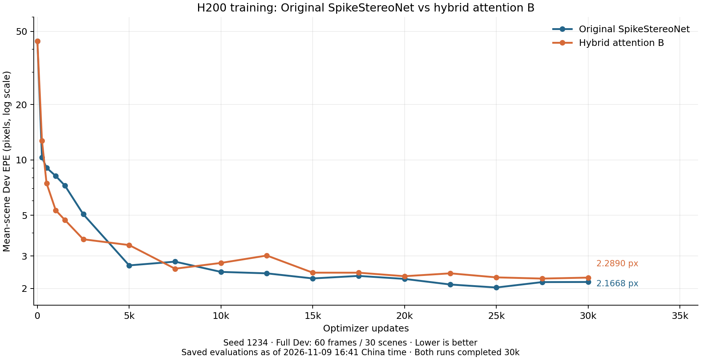

# H200 Original SpikeStereoNet versus hybrid attention B — completed 30k

This bundle was explicitly requested for Git publication on 9 November 2026. It is a scoped exception to the repository policy that normally keeps raw experimental artifacts outside Git.

Both fresh seed-1234 native CUDA runs completed 30,000 optimizer updates / 240,000 sample presentations. Both independent endpoint audits passed. All 17 full Dev evaluations (60 frames / 30 scenes each) and all 60,000 training rows are retained. These are **Dev** results; Test/confirmation inputs were not used. Final 30k checkpoints are the primary endpoints, not best intermediate checkpoints.

| Model | Mean-scene Dev EPE, px ↓ | Pooled bad3, % ↓ |
|---|---:|---:|
| Original non-I SpikeStereoNet | 2.166782641 | 10.219583032 |
| Hybrid attention B | 2.289049070 | 9.795966373 |

Hybrid B has **5.6428% higher EPE** (+0.122266429 px) and **0.423616658 percentage points lower bad3**. It wins EPE on 16/30 scenes; median paired Original-minus-B EPE is +0.013315909 px. Large scene errors reverse the aggregate mean: B improves scene_0134 by 5.821906686 px but worsens scene_0142 by 5.787927479 px and scene_0135 by 2.781356901 px. Keep every scene. This H200 seed did not reproduce the historical mean-EPE advantage; its cause is unresolved. One seed and a whole-B intervention do not establish robust architecture superiority or a uniquely spiking mechanism.



## Registered recipe and provenance

- Source revision: `28ca495f0b00e750735d38fe861cf9e15712b833`. The publication commit may contain newer upstream code; `source.tar.gz` is the exact 628-file execution capsule.
- Execution source identity: `9d9a1f4d9dfba49fe7f29fc232ce431e0d2697a429118c2aac3ee2012b526b74`.
- One H200 per model; physical batch 4, accumulation 2, effective batch 8; seed 1234, B branch seed 2017.
- AdamW max LR 2e-4, betas (0.9,0.999), epsilon 1e-8, weight decay 1e-5, global norm clipping 1. Native foreach/fused defaults.
- OneCycle: 30,000 updates, 1% rise, linear decay, div_factor 25, final_div_factor 10000, no cycle momentum.
- Native boolean-indexed sequence disparity L1, gamma 0.9; each microbatch weighted by its valid-pixel count over the full effective batch, with no additional division by two.
- 16 train / 32 Dev refinements; all 50 bins at 250×400; same fixed permutation and absolute-position H/V flips. Train 960 frames / 120 scenes; Dev 60 frames / 30 scenes.
- Python 3.12.3, PyTorch 2.7.1+cu128, CUDA 12.8, cuDNN 9.7.1, NVIDIA driver 580.105.08.
- FP32 / AMP off; cuDNN deterministic on and benchmark off; convolution TF32 allowed, matmul TF32 off; global strict determinism off. The NGC TF32-default environment variable was checked against the pinned PyTorch implementation; see `cuda-precision-audit.json`.
- Full B initialization matches historical tensor hash `b37335857fd34f9f5aaa1cf203f906304f7edbd965447ff7dad3953172d47bd4`; all 348 native tensors match between arms. All 3,060 selected Train/Dev raw file hashes matched the source dataset. No dataset contents are in this bundle.

## Validation history and timing conditions

The first cold CUDA output-parity attempt found a 0.0000308-px first-call difference also present in Original's own first-to-second forward. That attempt and its source are preserved in `validation-attempts/cold-first-call/`. A validator-only adjustment performs one unchanged-model warm forward before comparison: the same atol=rtol=1e-5 is retained, warmed output difference is zero, and model-state hashes remain unchanged. Production model/runtime/worker code did not change. Both models then passed three native updates and exact checkpoint recovery at update 2; these disposable preflight outputs are separate from scientific runs.

GPU7's nondefault clock setting was reset at the user's request during training. Updates through 8284 belong to the earlier clock condition; updates above 8437 belong to the restored condition; exclude the uninstrumented transition interval from timing comparisons. Other active processes subsequently shared both cards and reduced throughput. These are disclosed timing confounds, not established causes of the accuracy discrepancy. They did not reset the optimizer, schedule or sample stream. See `hardware-events.jsonl`, `gpu7-clock-reset.json`, and `gpu-sharing-observation.json`.

Historical CUDA reference aggregates are separately labeled in `summaries/historical-cuda-comparison.csv` (Original 2.691127 / B 2.034117 px at 30k). They are not fresh results. The exact archived cccl3/5090 job's complete frozen source/runtime metadata was not independently inspected; matching this documented recipe is not a bitwise-replay claim.

## Files and verification

- `seed-1234/<model>/train.jsonl.gz`: losslessly compressed, complete 30,000-row training logs, including sample IDs/flips, losses, gradient norms, learning rates, timing and device memory. `artifact-manifest.json` records both compressed file hashes and original uncompressed hashes.
- `evaluations.jsonl`: all 17 evaluations, including every frame/scene EPE and bad rate.
- `metadata.json`, `result.json`, `checkpoint.json`: resolved configuration, environment, completion counters, and checkpoint hashes. Model/optimizer checkpoints remain in the original run storage; their sizes/hashes are recorded by the endpoint audits. Large weights are not stored in Git.
- `summaries/`: final endpoints, all 30 scene deltas, complete EPE/bad3 curves, historical context and interpretation.
- `figures/`: final PNG and SVG EPE, bad3, loss and LR figures.
- `source.tar.gz`, `source-registry.json`: exact execution source and registered per-file hashes.
- `analysis/`: endpoint auditor, final analyzer and launch/watch controllers used for this run. Controllers contain original container paths and are provenance, not instructions to submit jobs.

Verify this bundle using the Python standard library:

```bash
python3 verify_bundle.py
```

To inspect a complete training log:

```bash
gzip -dc seed-1234/hybrid-b/train.jsonl.gz | less
```

All source licenses and upstream attributions are retained in the frozen source archive. Publication adds evidence only; it does not change model calculations or launch experiments.
