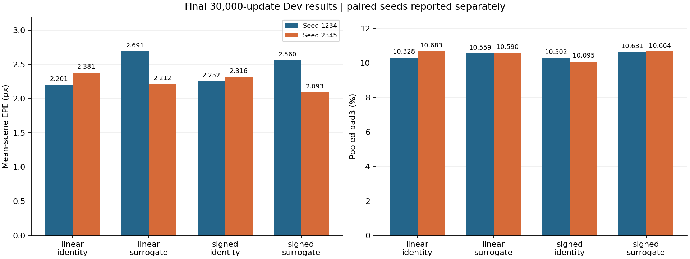
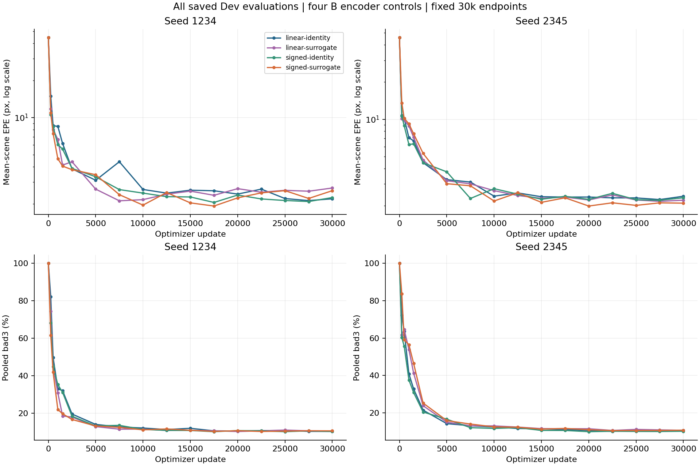

# NPU hybrid-B factorial ablation — eight completed 30k runs

Published at the user’s explicit request on 10 November 2026. This compact result bundle is a scoped exception to the repository’s normal policy of keeping experiment records outside Git. It contains no weights, dataset contents or raw training logs.

All four variants × seeds 1234 and 2345 completed **30,000 optimizer updates / 240,000 sample presentations each**. The saved summarizer audit reports all eight cells completed, checks the full sample/flip/LR streams and all 17 full Dev evaluations, and recomputes frame/scene aggregates. Final worker records report finite model/optimizer states. This publication does not claim a new independent tensor-by-tensor checkpoint audit.

## Fixed-30k Dev endpoints

| Variant | Seed 1234 EPE, px ↓ | bad3, % ↓ | Seed 2345 EPE, px ↓ | bad3, % ↓ |
|---|---:|---:|---:|---:|
| `linear-identity` | 2.200676 | 10.327967 | 2.380936 | 10.682967 |
| `linear-surrogate` | 2.690989 | 10.559350 | 2.211694 | 10.589817 |
| `signed-identity` | 2.252443 | 10.302484 | 2.315693 | 10.095367 |
| `signed-surrogate` | 2.559591 | 10.630500 | 2.092714 | 10.664151 |

`linear-identity` is ordinary continuous Q/K/V scaled dot-product attention within this specific B module: the encoder forwards projection values unchanged with identity gradients. B still has its 256→16 bottleneck, LayerNorm, bidirectional full-row stereo attention, continuous softmax, shared residual output projection and no added FFN. `signed-surrogate` is the original signed-T4 encoder with its surrogate derivative. The crossed cells change only the forward code or local encoder derivative. All variants use the same native spiking stereo backbone.

## Paired factorial contrasts

Positive values mean lower EPE for the intervention. C = linear identity, G = linear surrogate, S = signed identity, H = signed surrogate. The registered ±0.05 px band is descriptive, not a significance test.

| Contrast | Formula | Seed 1234, px | Seed 2345, px |
|---|---|---:|---:|
| hybrid_package | C−H | -0.358915 | +0.288222 |
| forward_at_identity | C−S | -0.051767 | +0.065243 |
| forward_at_surrogate | G−H | +0.131398 | +0.118980 |
| surrogate_at_linear | C−G | -0.490313 | +0.169242 |
| surrogate_at_signed | S−H | -0.307148 | +0.222979 |
| interaction | S+G−H−C | +0.183165 | +0.053737 |

Hybrid B versus ordinary attention reverses between seeds: −0.358915 px for seed 1234 and +0.288222 px for seed 2345. Overall hybrid superiority is **not reproduced consistently**. Signed forward encoding improves EPE when the surrogate backward rule is held fixed (G−H = +0.131398 / +0.118980 px), and the interaction is positive in both seeds (+0.183165 / +0.053737 px). These are preliminary conditional training-intervention effects; they do not establish a uniquely discrete-spike mechanism.

Signed identity has the lowest bad3 in both seeds. Its two-seed mean EPE is only about 0.0067 px below linear identity, inside the descriptive practical band; averaging should not conceal the opposite paired EPE effects. Two seeds are preliminary, and scenes are not extra training seeds.

## All-scene distribution

| C minus H at 30k | H scene wins / 30 | Median paired EPE difference, px | Five hardest C scenes: share of net mean difference |
|---|---:|---:|---:|
| Seed 1234 | 15 | -0.000827 | 45.34% |
| Seed 2345 | 16 | +0.021196 | 125.96% |

All scenes are retained in `summaries/scene-deltas.csv`, including every pair and saved evaluation. Positive C−H differences favor H. A signed net contribution can exceed 100% or be negative when other scenes offset it; it is not a fraction of scenes benefiting. Interpret mean gaps with the scene distribution and bad3, not as universal improvement.

## Recipe and execution identity

- Protocol: [hybrid-b-ablation-911-NPU.md](../../../projects/snn-depth-estimation/experiments/b-attention-mechanism-v1/hybrid-b-ablation-911-NPU.md). Study label `911` is not an accelerator model or training seed.
- Actual run directory was `outputs/hybrid-b-ablation-911-NPU-a4`; `config.json` retains the registered study label without the attempt suffix. Earlier attempts are not mixed into these eight endpoints.
- One Ascend NPU per model, devices 0–7; physical microbatch 4, accumulation 2, effective batch 8. Eight fresh runs; no historical trained endpoint reused.
- AdamW max LR 2e-4, betas (0.9,0.999), eps 1e-8, weight decay 1e-5, clip norm 1; foreach/fused off. Fixed 30k linear OneCycle with pct_start 0.01.
- Native boolean-indexed sequence L1, gamma 0.9; microbatch valid-count weighting without an extra division by two. 16 train / 32 Dev refinements.
- Native 50-bin 250×400 inputs; train 960 frames / 120 scenes, Dev 60 frames / 30 scenes. Fixed paired order, absolute-position H/V flips; no Test/confirmation inputs used.
- FP32, AMP/HF32/JIT off; strict determinism off throughout. Preload 12 GiB/process, two preparation workers, depth two. Full resolved per-cell settings and actual environments are in `metadata.json`.
- Execution source revision: `cf45a2fb6280c12f11dc0c1c83855ec0125449c6`; source identity `362cf2fcd23231035a219ba281b11d85772d0c3458c1c243fd4370ffd913ded9`. The recorded dirty status consists of retained NPU adapter files; the publication does not change architecture or training code.
- All four cells within each seed have identical initialization, source and audited sample/LR stream identities. Seed 1234 initialization matches historical full-B hash `b37335857fd34f9f5aaa1cf203f906304f7edbd965447ff7dad3953172d47bd4`; seed 2345 uses its own paired initialization.
- The fresh signed-surrogate/1234 result (2.559591 px) differs from the earlier Original-versus-B study’s historical B/1234 result (1.938088 px), despite matching recorded initialization. That earlier endpoint is context only and is not reused or averaged into this batch; the cause of the cross-study difference is not established.

## Files and verification

- `summaries/endpoints.csv`: all eight fixed 30k EPE/bad3 endpoints.
- `summaries/curves.csv`: EPE/bad3 at all 17 Dev evaluations for all eight cells.
- `summaries/factorial-contrasts.csv`: all six contrasts per seed and evaluation.
- `summaries/scene-deltas.csv`: all 30 scenes, six variant pairs, two seeds and 17 evaluations.
- `summaries/completion-audit.json`: saved full-history summarizer audit. `seed-*/<variant>/{metadata,result}.json`: resolved environment/configuration and completion records.
- `source-registry.json`, `initializations/metadata.json`, `config.json`, `matrix.json`, `reuse-decision.json`: source, initialization, allocation and fresh-run provenance.
- Raw JSONL logs and `last.pt`, `step-7500.pt`, `step-30000.pt` remain in the original remote run storage and are not part of this compact publication.
- `artifact-manifest.json` hashes every published artifact. Run `python3 verify_bundle.py` from this directory to verify hashes and table/record consistency. This verifier does not load remote weights or re-audit the omitted raw logs.
