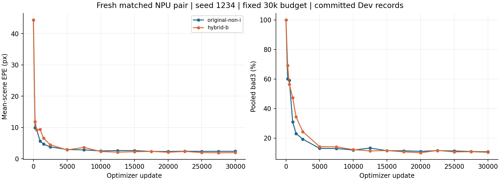
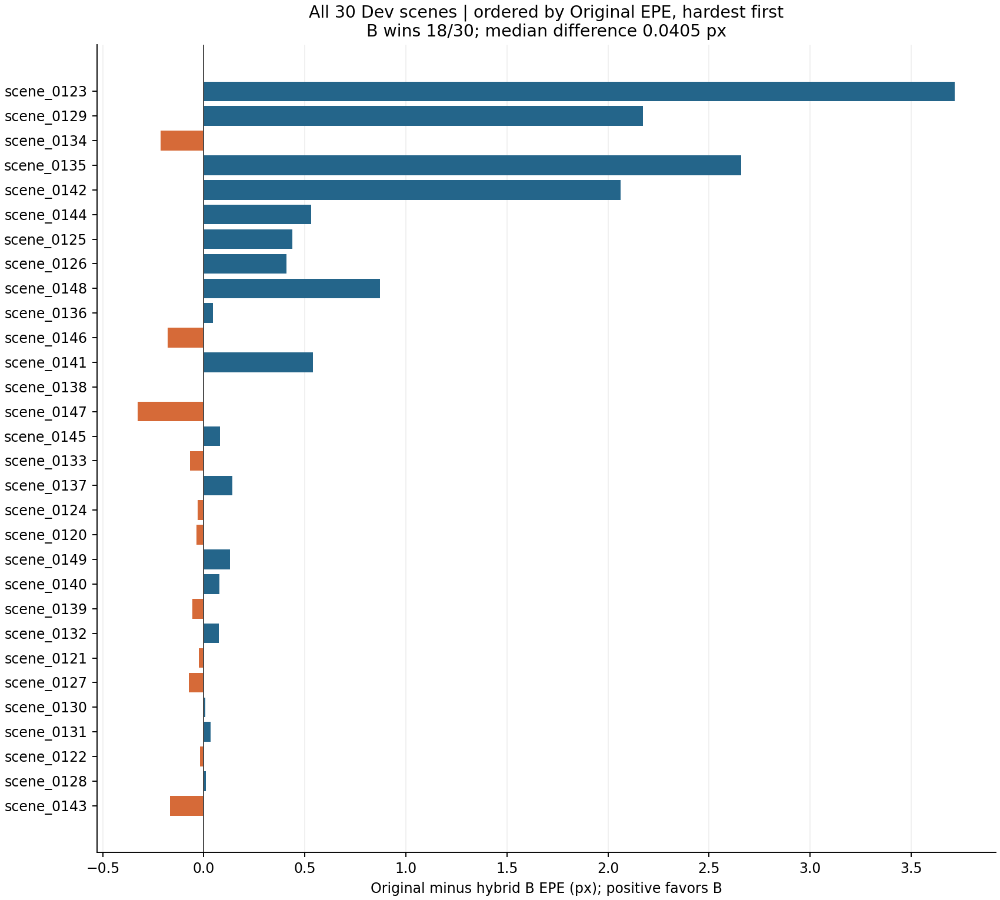

# Original SpikeStereoNet versus hybrid B: 30k NPU results

Completed 9 November 2026. Both seed-1234 models trained fresh for **30,000 updates / 240,000 sample presentations each**. Both endpoint audits passed. This directory reports only this matched NPU pair.

| Model | Mean-scene EPE, px ↓ | Pooled bad3, % ↓ |
|---|---:|---:|
| Original non-I SpikeStereoNet | 2.364822 | 10.688950 |
| Hybrid attention B | 1.938088 | 10.302884 |

Hybrid B reduced EPE by **0.426734 px (18.05%)** and bad3 by **0.386067 percentage points**. It improved **18/30 Dev scenes**; median paired EPE improvement was **0.040463 px**. The five highest-error Original scenes account for **81.19% of the net mean improvement**. All scenes remain in the analysis.

This supports a benefit for the complete B addition at this seed under the registered recipe. The difficult-scene concentration and single training seed limit generalization; this comparison does not establish a uniquely spiking advantage.

## Recipe and completion

- One Ascend910B2C per model, concurrently on separate devices; physical microbatch 4, accumulation 2, effective batch 8.
- FP32, native masked disparity loss; AdamW max LR 2e-4 and 30k OneCycleLR. All 50 sensor bins at native 250×400 resolution; 16 train / 32 Dev refinements.
- Fixed policy from initialization: AMP/HF32/JIT/strict determinism off. Hybrid B preserves activation checkpointing. Shared native initial tensors and historical B branch seed 2017.
- All 17 planned Dev evaluations completed, 60 frames / 30 scenes each. No Test/confirmation access or best-interim selection.
- Worker runtimes: Original **21 h 19 m 33 s**; hybrid B **21 h 26 m 39 s**. These are concurrent job runtimes, not an isolated backend speed comparison.
- Audits verified frozen source, sample/flip/LR history, finite model/optimizer state, final counters, retained 7.5k checkpoint, and exact final named-versus-last checkpoint state.

## Files

- [Endpoint table](endpoints.csv), [all paired scenes](scene-deltas.csv), [full Dev curves](curves.csv).
- [Results and scene concentration](results.json), [resolved configurations and environment](run-config.json), [verification record](verification.json), [artifact hashes](SHA256SUMS).

## Provenance and retained evidence

Protocol: [spikestereonet-npu-baseline.md](../../projects/snn-depth-estimation/experiments/b-attention-mechanism-v1/spikestereonet-npu-baseline.md), source revision `28ca495f0b00e750735d38fe861cf9e15712b833`. Frozen execution source identity: `bd52f3c6e77c611141ff4ed570fa9d22ebbaeaeeb76ffb1980e0f4062d58387f` (includes the uncommitted NPU adapters used for execution).

Dataset split SHA256: `bad4369b6fd8b0cdf871a20b1727c2d9b59733a16bd33f75904227bdfef4510a`. All-native initialization SHA256: `8ceac15b09ce188f9ee52ad5a8eca8e68727cbbb2887a012874d7246dc6495ca`.

The protocol's output directory is `projects/snn-depth-estimation/experiments/b-attention-mechanism-v1/outputs/original-hybrid-b-npu-30000-v1/`. Complete raw JSONL logs, frozen source archive and large checkpoints are retained outside Git. Checkpoint hashes and sizes are recorded in `verification.json`; no dataset, raw log archive or weights are included in this export.

This results-only addition is explicitly requested by the user as an exception to the repository's normal outside-Git research-artifact policy. It changes no model or training source.
